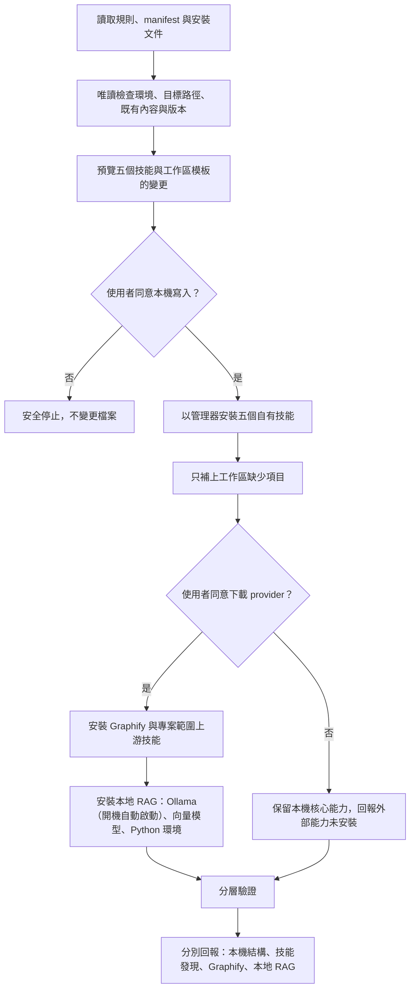

# 交給 AI Agent 的安裝入口

本文件是 `My Real Second Brain` 的人類可讀入口；`install.manifest.toml` 是機器可讀的單一依據。一般使用者只要指定想使用的 Agent 與工作區，不需要自行複製五個技能或研究內部目錄。

目前狀態是「可安裝候選版，等待外部驗收」，不是正式支援。自有技能與工作區可在不連線外部帳號的情況下安裝；Graphify 與本地 RAG（Ollama、`qwen3-embedding:4b` 向量模型、Python 環境）是分開的後續關卡。全部由 Agent 執行，你不需要輸入任何指令，也不需要登入任何帳號。

## 安裝流程

## Agent 執行規則

1. 完整讀取 `docs/installation.md`、`docs/client-compatibility.md`、`docs/providers.md` 與 `docs/integrations/local-rag.md`。
2. 技能清單、來源、版本、registration 與 provider 固定版本一律來自 manifest，不依文件段落自行猜測。
3. 先做唯讀預覽；寫入技能、初始化工作區、下載、安裝、更新或移除 provider 前，分別取得使用者同意。所有命令由 Agent 執行，使用者只回答同意與否。
4. 使用 `scripts/manage_install.py` 管理五個自有技能。相同版本重跑應為 no-op；不同版本不得由 `install` 靜默取代。
5. 先執行 `workspace-status`，再於使用者確認後執行 `init-workspace`。模板只新增缺少項目；既有一般檔案即使內容不同也原樣保留，檔案與目錄類型衝突則在寫入前停止。
6. 自有技能的狀態、快照與隔離區必須位於 Agent 技能掃描目錄外，而且不得保存憑證或知識內容。
7. Graphify 與本地 RAG 的外部元件都是 C 級外部來源：先宣讀標準外部來源提醒，再安裝當下最新版；不 clone 上游 repository。manifest 的 `tested_version` 只是參考紀錄。
8. 本地 RAG 目標是 16 GB 記憶體以上的 Mac：Homebrew 安裝 Ollama 並以 `brew services start ollama` 設為開機自動啟動、下載 `qwen3-embedding:4b`（約 2.5 GB）、在 `sources/rag/.venv` 建立 Python 環境。使用時約佔 3.1 GB 記憶體，閒置約 2 分鐘後自動釋放。
9. Graphify 是關係與導覽工具，本地 RAG 是查原文的工具；兩者不可取代本機核心資料。
10. 驗證失敗時停止並保留既有內容。移除自有技能不會移除 provider，也不會刪除第二大腦工作區。

## 已安裝舊版（使用 NotebookLM）的使用者

新版不再使用 NotebookLM，改用在你電腦上執行的本地 RAG。請直接告訴 Agent「幫我升級 AI 知識庫」，Agent 會依 `docs/installation.md` 第 8 節處理：

1. 先告訴你：NotebookLM 已不再使用，但你在 NotebookLM 裡的筆記本和資料**都不會被刪除**。
2. 更新五個技能，替你的工作區補上 `sources/inbox/`、`sources/external/` 與 `sources/rag/`；你原本的檔案都會保留。
   - 你原本的 `sources/.graphifyignore` 不會被覆蓋。Agent 先給你看變更、經你同意後，把舊的 `wiki/` 這一行**取代**成 `wiki/*` 與 `!wiki/ext_*.md`，讓外部原文的摘要頁能進圖譜。
3. 安裝 Ollama 並設為開機自動啟動、下載向量模型、建立 Python 環境。
4. 詢問你要不要把 NotebookLM 的原始來源下載到收件匣；要的話再協助，不要就跳過。
5. 電腦上原本安裝的 `notebooklm-py` 可以留著，不會被強制移除。

完整命令、更新與回復方式，以及各層驗證標準請見 `docs/installation.md`。
