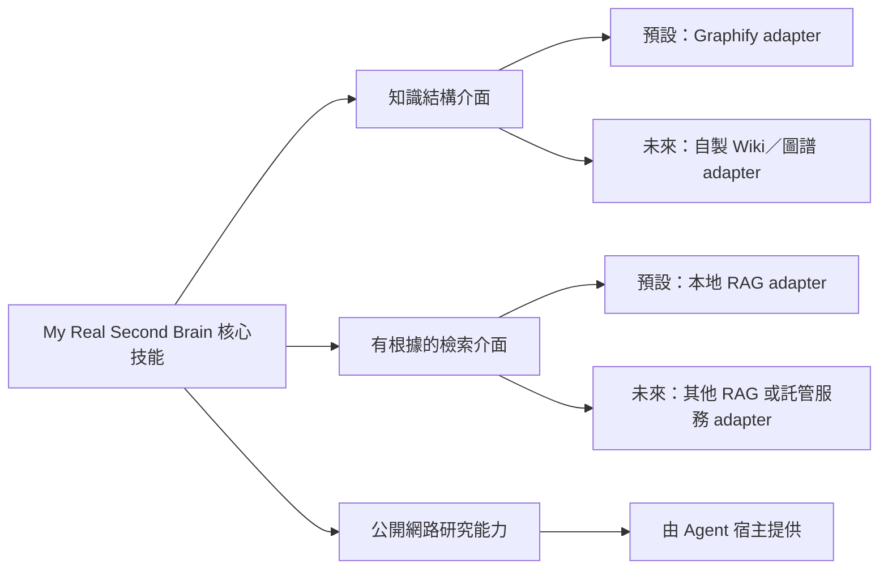

# 可替換後端契約

## 原則

`My Real Second Brain` 的核心是第一大腦心得、次級資料、知識生命週期、來源優先度與引用規則，不是 Graphify 或本地 RAG。兩者只是目前預設的後端實作。

## 版本查證與決策

| Provider | 安裝政策與已測版本 | 2026-10-31 查到的最新正式版 | 套件來源 | 授權 | 本次決策 |
|---|---|---|---|---|---|
| Graphify | C 級 `latest`（安裝當下的最新版）；已測版本 `0.9.35` 僅供參考 | [`0.9.99`](https://pypi.org/project/graphifyy/0.9.99/) | [PyPI 0.9.35](https://pypi.org/project/graphifyy/0.9.35/)、[v0.9.35 release](https://github.com/Graphify-Labs/graphify/releases/tag/v0.9.35) | Apache-2.0，並保留適用的舊 MIT 條款 | 依 ADR 0006 告知標準外部來源提醒後安裝最新版；`0.9.35` 的紀錄只用來核對與回報差異，最新版尚未在隔離環境完成本技能包相容性測試。 |
| 本地 RAG | 自有腳本（隨範本提供）；外部元件 Ollama、`qwen3-embedding:4b`、lancedb、pyarrow、jieba、pypdf、requests 皆為 C 級 `latest` | 依安裝當下 | [Ollama Homebrew formula](https://formulae.brew.sh/formula/ollama)、[Ollama 模型庫](https://ollama.com/library/qwen3-embedding)、PyPI | 腳本依買家授權；元件見 `THIRD_PARTY_NOTICES.md` | 2026-10-31 起取代 NotebookLM／`notebooklm-py`。等待外部驗收；維護者單機參考數字見 `docs/integrations/local-rag.md`。 |

Graphify 的 manifest 另保存已測版本 `0.9.35` 的 tag、commit、wheel 與 sdist SHA-256，供回報差異與追溯；實際安裝的是最新版，這些雜湊不用來阻擋安裝，也不代表套件已在目標電腦成功安裝。

目前兩者都屬於「可安裝的候選後端，等待外部驗收」，不是正式支援；兩者都不鎖定版本，依各元件的 `version_policy = "latest"` 安裝。未安裝或失效時，技能仍應先回覆本機可取得的知識並清楚說明限制。

## 能力一：知識結構後端

目前預設：Graphify。

後端至少應提供：

- 檢查安裝與健康狀態。
- 從指定本地來源建立或更新結構。
- 查詢節點、關係、路徑與來源。
- 保留抽取、推論與不確定性的標記。
- 提供人類可以探索的視覺化，或明確宣告不支援。
- 偵測過期、異常縮減與不安全重建。

## 能力二：有根據的外部檢索後端

目前預設：本地 RAG（Ollama + `qwen3-embedding:4b` + LanceDB），腳本位於工作區的 `sources/rag/scripts/`。規格見 `docs/integrations/local-rag.md`。

後端至少應提供：

- 從單一收件匣匯入來源，並回報哪些已建立索引、哪些交給 Agent 整理、哪些失敗。
- 針對已匯入的原文查詢，回傳可追溯的檔案與段落標題。
- 匯入後在 Wiki 留下可被知識結構後端讀取的摘要頁，連回原文。
- 回報執行狀態與錯誤，失敗的檔案保留在原處。
- 不把登入秘密寫入本機檔案；預設實作完全不連網、不上傳。

2026-10-31 以前的版本使用 Google NotebookLM（由 `notebooklm-py` 操作）。升級後不刪除使用者的 NotebookLM 資料，也不強制移除 `notebooklm-py`；舊的 `sources/references/notebooks/` 保留為歷史紀錄。

## 能力三：公開網路研究能力

`socratic-dialogue` 在第二大腦資料不足、可能過時或缺少可信反方時，需要使用目前 Agent 可用的公開網路研究能力。這項能力由 Agent 宿主提供，不在 `install.manifest.toml` 鎖定特定搜尋服務。

至少應能：

- 搜尋並開啟公開網頁。
- 優先找到官方文件、原始研究、第一方資料與原始統計。
- 分辨發布日期、更新日期與資料可能過期的風險。
- 在回答中提供可以直接開啟的原始網址。
- 說明每個來源支持、補充或挑戰哪一項說法。
- 無法上網時明確回報限制，不假裝已完成查證。

網路資料預設只用於當次對話。只有使用者明確要求長期保存時，才依 `template/sources/references/README.md` 的格式寫入 `sources/references/`。

## 核心與後端的邊界

核心技能應表達「建立知識結構」「查詢外部集合」「取得引用」，而不是永久寫死某個上游命令。預設 adapter 呼叫 Graphify 與本地 RAG 腳本，未來可以替換成自製 Wiki、其他圖資料庫、其他向量資料庫或託管服務。

替換 provider 不得要求改寫使用者的讀書筆記、次級資料、Wiki 或來源索引格式；若能力不等價，adapter 必須明確回報差異。

## 更新與回復政策

1. 先查證 PyPI、固定 tag、發行說明與授權，再提出版本變更。
2. 在隔離環境測試套件安裝、專案範圍技能、三種 Agent 發現與既有工作區相容性。
3. 通過後才更新 manifest 的已測版本、commit 與發行檔雜湊。
4. 保留前一個已驗證規格；最新版不相容時，向使用者說明後改裝已測版本並重新驗證。
5. 套件、上游技能、登入狀態、本機索引與遠端資源分開管理，不使用一個「解除安裝」命令推論其他層已移除。
