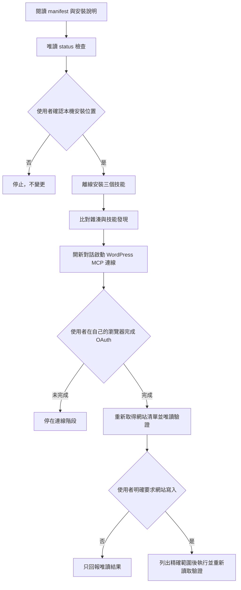

# WordPress MCP 工作流安裝

本安裝器離線複製三個技能，不會開啟 OAuth、不會讀取瀏覽器資料，也不會連線或修改 WordPress。實際登入與網站操作是安裝完成後的另一個階段。



## 1. 唯讀預覽

先選擇技能入口與位於技能掃描目錄外的狀態目錄。下列路徑都是佔位符：

```text
python3 scripts/manage_install.py status \
  --registration agents_workspace \
  --client-root <workspace>/.agents/skills \
  --state-root <local-state-root>
```

可用 registration：

- `agents_workspace`：Codex 或 Antigravity 專案技能。
- `claude_workspace`：Claude Code 專案技能。
- `codex_user`、`claude_user`：使用者層級技能。
- `antigravity_desktop_user`、`antigravity_cli_user`：Antigravity 使用者層級技能。

`status` 只讀取來源、目標與本包自己的非敏感安裝狀態。若目標已有不同內容的同名技能，結果會是 `blocked`，不覆寫。

## 2. 安裝與生命週期

使用者確認本機寫入範圍後，把 `status` 換成 `install`。管理器另支援：

- `update`：更新到目前候選版，先保存可回復快照。
- `rollback`：回復最近一次更新前的版本。
- `remove`：將受管理技能移到狀態目錄的隔離區，不永久刪除。
- `status`：檢查安裝、變更、衝突與可用更新。

不同內容的同名入口、安裝後人工修改、symlink、損壞狀態或不符合 manifest 的來源都會安全停止。

## 3. 連接 WordPress.com

安裝完成後，重新啟動或開新對話，讓 Agent 先讀取 `wordpress-mcp-workflow`：

1. 每位使用者在自己的瀏覽器中檢查 OAuth 權限並親自登入。
2. 不把 OAuth 網址、授權碼、Token、Cookie 或帳號密碼貼進對話、技能檔案或 Git。
3. 連線後先取得即時網站清單，核對主要網域、別名與重新導向。
4. 先完成唯讀操作；只有使用者明確要求特定網站寫入時，才執行那個範圍。
5. 寫入後以 MCP 重新讀取；公開頁面另用真實瀏覽器檢查電腦版與行動版。

若當前 Agent 沒有載入 WordPress MCP 工具，停止遠端寫入，重新載入連線或開新對話；不得改用瀏覽器後台操作冒充 MCP 驗收。

## 4. 驗證

維護者可在套件根目錄執行：

```text
python3 tests/validate_package.py
python3 -m unittest discover -s tests -p 'test_*.py'
```

通過只代表技能包結構與本機安裝生命週期可用；OAuth、真實帳號、方案能力、網站寫入與視覺成果仍須由每位使用者在自己的環境驗收。
